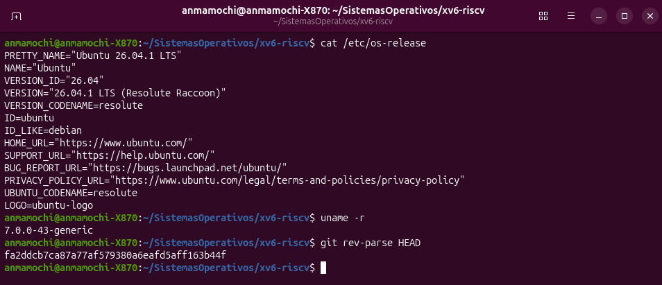
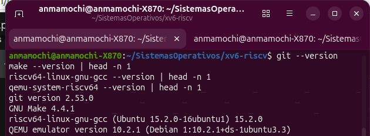
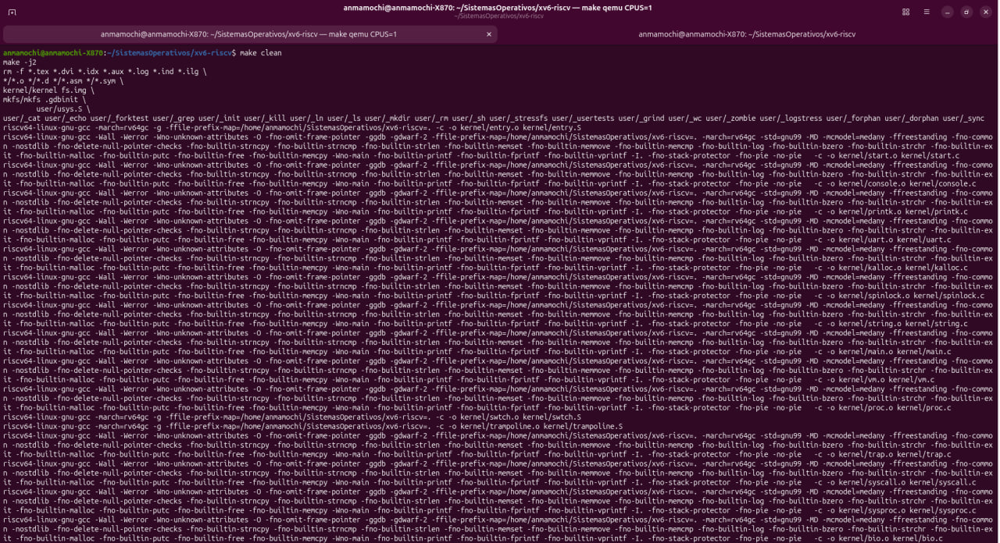
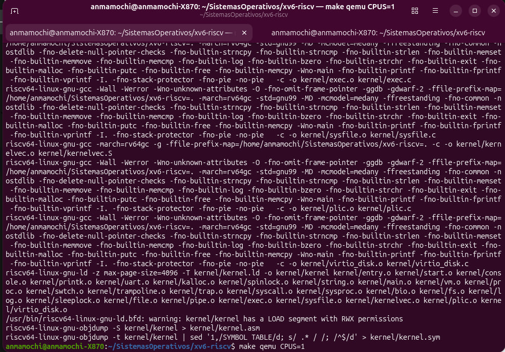
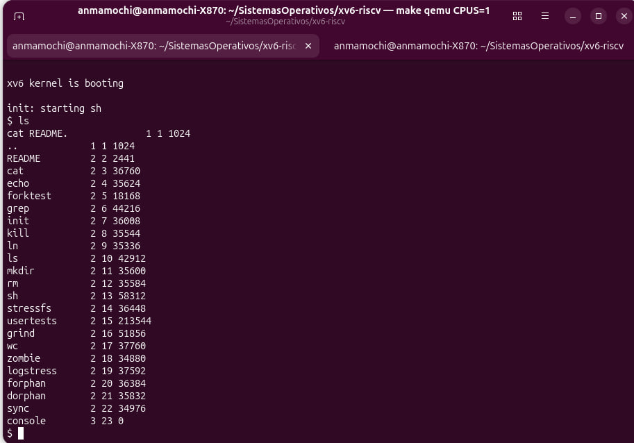
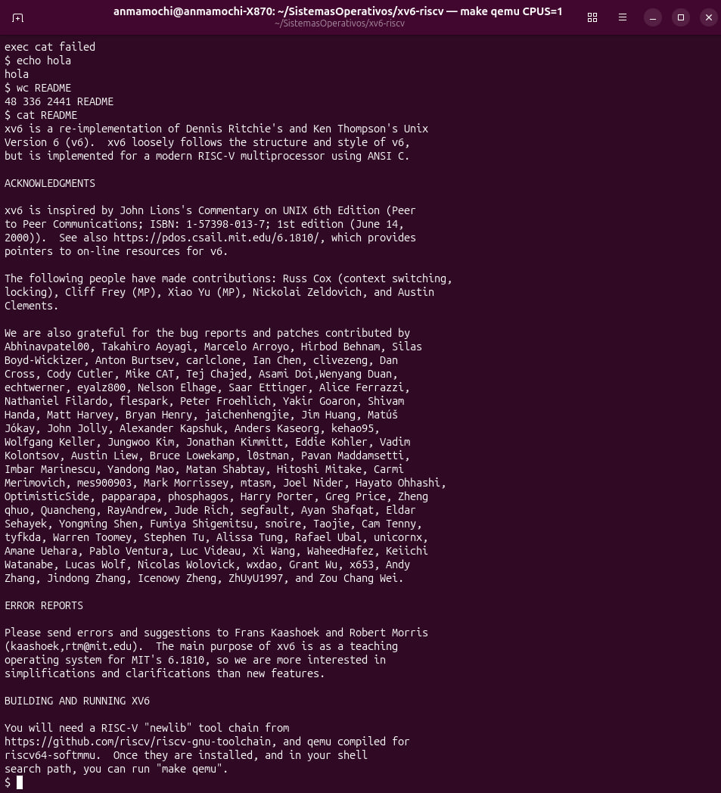
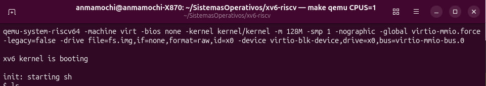
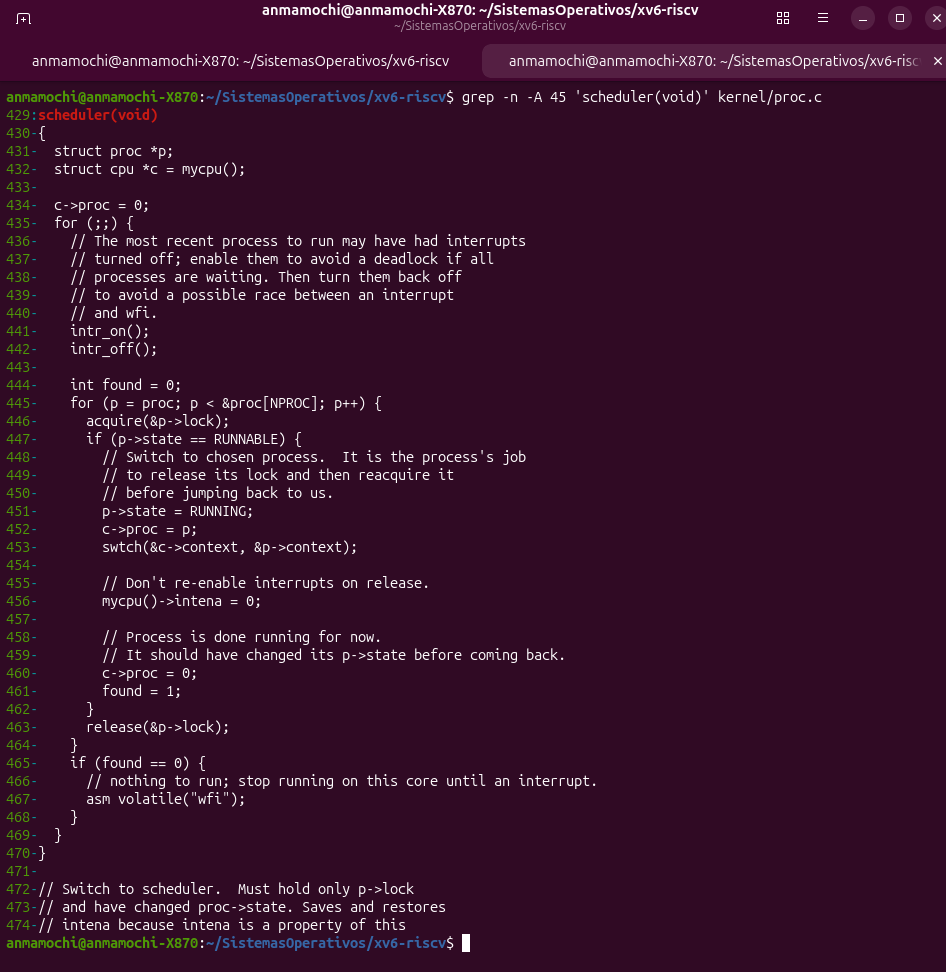
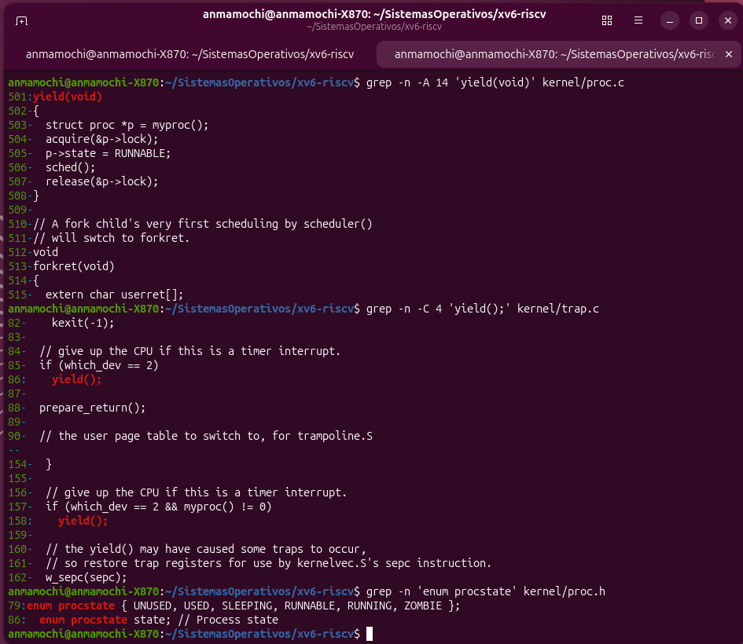
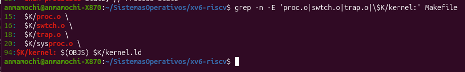

# Exploración de la planificación de procesos en XV6 (RISC-V)

**Asignatura:** Sistemas Operativos  
**Modalidad:** trabajo en parejas  
**Fecha indicada por la consigna:** 16 de noviembre de 2026  
**Integrante 1:** Andrés Mauricio Molina Chilito  
**Integrante 2:** Jorge Luis Obando Carabalí  
**Fork:** https://github.com/andreschilito/xv6-riscv  
**Commit inicial:** `fa2ddcb7ca87a77af579380a6eafd5aff163b44f`


## 1. Preparación del repositorio y entorno

### 1.1. Repositorio y revisión inicial

Clonamos nuestro fork desde Ubuntu con estos comandos:

```bash
mkdir -p ~/SistemasOperativos
cd ~/SistemasOperativos
git clone https://github.com/andreschilito/xv6-riscv.git
cd xv6-riscv
git rev-parse HEAD
```

El último comando nos mostró el siguiente commit:

```text
fa2ddcb7ca87a77af579380a6eafd5aff163b44f
```

**Directorio de trabajo:** `~/SistemasOperativos/xv6-riscv`. El identificador anterior fija la revisión de partida reportada por el equipo. Para confirmar la rama y el estado en el computador, aún puede ejecutarse `git branch --show-current` y `git status --short`.

**Distribución Linux:** **Ubuntu 26.04.1 LTS (Resolute Raccoon)**, identificador `26.04`, según `cat /etc/os-release`.  
**Kernel Linux:** **`7.0.0-43-generic`**, según `uname -r`.  
**Revisión de partida:** `fa2ddcb7ca87a77af579380a6eafd5aff163b44f`, confirmada nuevamente con `git rev-parse HEAD`.

**Evidencia 0 — Ubuntu, kernel Linux y revisión inicial:**



### 1.2. Herramientas instaladas

Para revisar las herramientas ejecutamos `git --version`, `make --version | head -n 1`, `riscv64-linux-gnu-gcc --version | head -n 1` y `qemu-system-riscv64 --version | head -n 1`, y obtuvimos estas versiones:

| Herramienta | Versión observada | Uso |
| --- | --- | --- |
| Git | `2.53.0` | Clonar y versionar el proyecto. |
| GNU Make | `4.4.1` | Construir XV6 mediante `Makefile`. |
| `riscv64-linux-gnu-gcc` | `15.2.0` (`Ubuntu 15.2.0-16ubuntu1`) | Compilar C para RISC-V. |
| QEMU RISC-V | `10.2.1` (`Debian 1:10.2.1+ds-1ubuntu3.3`) | Emular la máquina RISC-V. |
| Binutils RISC-V (`ld`, `objdump`) | No registramos el número de versión | Enlazar e inspeccionar los objetos. |
| `bc` | No registramos el número de versión | Herramienta auxiliar del `Makefile`. |


**Evidencia 1 — versiones:**



## 2. Compilación y ejecución de XV6

### 2.1. Compilación

Para compilar entramos a la carpeta del repositorio y usamos:

```bash
make clean
make -j2
```

En la terminal vimos varios comandos de GCC para compilar los archivos del kernel, entre ellos `kernel/proc.c`. Después apareció el comando que une los archivos objeto para generar `kernel/kernel`. Salió una advertencia del enlazador sobre permisos `RWX`, pero la compilación no se detuvo y después pudimos arrancar XV6.

**Evidencia 2 — compilación de archivos del núcleo:**



**Evidencia 3 — enlazado y conclusión de compilación:**



### 2.2. Arranque y comandos del sistema

Para arrancar XV6 utilizamos:

```bash
make qemu CPUS=1
```

En la terminal aparecieron estos mensajes:

```text
xv6 kernel is booting
init: starting sh
$ ls
```

Con `ls` aparecieron archivos y programas como `README`, `cat`, `sh` y `ls`. El sistema arrancó, abrió el shell y nos dejó escribir comandos.

**Evidencia 4 — arranque y `ls`:**



**Evidencia 5 — comandos `echo`, `wc` y `cat`:**

Probamos `echo hola`, que mostró `hola`. Con `wc README` obtuvimos `48 336 2241 README` (48 líneas, 336 palabras y 2241 bytes). También ejecutamos `cat README` y pudimos leer su contenido.

Primero nos salió `exec cat failed`, pero después repetimos el comando y sí funcionó. No llegamos a comprobar por qué falló la primera vez.



### 2.3. Configuración de una única CPU virtual

Ejecutamos `make qemu CPUS=1` y revisamos que el comando de QEMU tuviera **`-smp 1`**, que significa una CPU virtual. No tuvimos que cambiar nada en los procesadores físicos del computador. También vimos `-kernel kernel/kernel`, que es el archivo que compilamos.

**Evidencia 6a — comando de lanzamiento desde Ubuntu:**


**Evidencia 6b — configuración `-smp 1` y arranque:**



Como comprobación adicional, desde el shell de **Ubuntu** (fuera de XV6) se puede ejecutar:

```bash
make -n qemu CPUS=1 | grep -- '-smp'
```

La salida debe conservar `-smp 1`. 

## 3. Investigación del planificador de XV6

> **Base de análisis:** se contrastó directamente `kernel/proc.c:scheduler()` con la salida real del comando `grep -n -A 45 'scheduler(void)' kernel/proc.c` ejecutado en el clon del fork después de confirmar el commit `fa2ddcb7ca87a77af579380a6eafd5aff163b44f`. La captura permite verificar las líneas **429–470**. Las funciones `yield()`, `usertrap()`, `kerneltrap()` y los estados también se revisaron después con comandos ejecutados sobre el clon local. 

### 3.1. Política por defecto

XV6 RISC-V emplea una planificación **tipo Round Robin**. El código de `scheduler()` inspecciona repetidamente la tabla de procesos `proc[]`; cuando un proceso tiene estado `RUNNABLE`, lo convierte en `RUNNING` y cambia al contexto de ejecución del proceso. En la versión educativa estudiada no hay una estructura de varias colas de prioridad ni una comparación de prioridades dinámica en ese selector.

Por lo que vimos, funciona como Round Robin mediante un recorrido repetido de la tabla, no con una cola FIFO que hayamos encontrado en el código. Hay que tener en cuenta que los procesos también pueden detenerse o ceder CPU. La captura de `ls` demuestra que el sistema funciona, pero no mide el orden de los turnos de los procesos.

**Ruta y función principales:** `kernel/proc.c`, `scheduler()`.

**Extracto verificado del selector (líneas 445–467 de `kernel/proc.c`, con comentarios omitidos):**

```c
for (p = proc; p < &proc[NPROC]; p++) {
  acquire(&p->lock);
  if (p->state == RUNNABLE) {
    p->state = RUNNING;
    c->proc = p;
    swtch(&c->context, &p->context);
    mycpu()->intena = 0;
    c->proc = 0;
    found = 1;
  }
  release(&p->lock);
}
if (found == 0) {
  asm volatile("wfi");
}
```

La función `scheduler()` comienza en la **línea 429** y contiene un ciclo externo infinito `for (;;)` (**línea 435**). En cada vuelta recorre las entradas de la tabla `proc[]` (**línea 445**), adquiere `p->lock` (**línea 446**) y solo despacha procesos cuyo estado sea `RUNNABLE` (**línea 447**). Antes de cambiar de contexto, registra `RUNNING` (**línea 451**) y la referencia de la CPU al proceso (**línea 452**); la transferencia ocurre en `swtch()` (**línea 453**). Cuando retorna, limpia `c->proc`, marca que encontró trabajo y libera el candado. Si no encontró ningún proceso ejecutable, ejecuta `wfi` (**líneas 465–467**), esperando una interrupción. La decisión de seleccionar procesos se toma, por tanto, en `scheduler()`; `swtch()` realiza el cambio de contexto y no compara prioridades.

**Evidencia 7 — lectura del planificador original en el clon local:**



**Alcance de la evidencia:** respalda de manera directa la identificación del archivo, función, condición de elegibilidad, transición de estado y cambio de contexto. 


### 3.2. Estados de los procesos

En nuestro repositorio, `kernel/proc.h`, línea 79, aparece esta declaración:

```c
enum procstate { UNUSED, USED, SLEEPING, RUNNABLE, RUNNING, ZOMBIE };
```

| Estado | Interpretación | Evento de interés |
| --- | --- | --- |
| `UNUSED` | Entrada de la tabla libre. | Se reserva mediante `allocproc()`. |
| `USED` | Proceso reservado que todavía no está listo para ejecutar. | Se completa su inicialización. |
| `RUNNABLE` | Está listo y compite por CPU. | `scheduler()` puede seleccionarlo. |
| `RUNNING` | Ocupa la CPU actual. | Interrupción, cesión, sueño o terminación. |
| `SLEEPING` | Espera un evento; no puede elegirse. | Las rutas de despertar pueden devolverlo a `RUNNABLE`. |
| `ZOMBIE` | Terminó y aún no se ha recolectado. | Espera recolección por el padre. |

El recorrido central es:

```text
RUNNABLE --scheduler()/swtch()--> RUNNING
RUNNING --yield()/sched()-------> RUNNABLE
RUNNING --sleep()--------------> SLEEPING
SLEEPING --wakeup()------------> RUNNABLE
RUNNING --kexit()--------------> ZOMBIE
```

**Cuando un proceso cede la CPU:** revisamos `kernel/proc.c` y encontramos que `yield()` (líneas 501–508) cambia el estado a `RUNNABLE` y llama a `sched()`. En pocas palabras, el proceso deja de ejecutarse por el momento y queda listo para que el planificador pueda elegirlo otra vez. El cambio de contexto se hace con `swtch()` en `kernel/swtch.S`.

```c
// En el cuerpo de yield():
p->state = RUNNABLE;
sched();
```

**Interrupciones del reloj:** también buscamos `yield();` en `kernel/trap.c`. En las líneas 84–86 y 156–158 encontramos que, cuando `which_dev == 2` (interrupción de reloj), se puede llamar a `yield()`. En el segundo caso además se comprueba `myproc() != 0`. Así un proceso que lleva rato usando CPU puede dejarle el turno a otros. Esto no significa que todos ejecuten exactamente la misma cantidad de tiempo.

**Espera y recuperación:** en la revisión pública consultada, se usan `sleep_prepare()`, `sleep()` y `wakeup()` de `kernel/proc.c` para relacionar espera, estado `SLEEPING` y regreso a `RUNNABLE`. La interfaz exacta debe revisarse en el fork, porque algunas revisiones antiguas de XV6 tienen una función `sleep` con parámetros diferentes.

La distinción entre estados y prioridad es esencial: aun si se propusiera dar la máxima prioridad a un proceso, **no podría ejecutarse mientras esté `SLEEPING`**.

**Evidencia 8 — estados, `yield()` e interrupciones:**



En esta captura juntamos los tres comandos que usamos para mirar esas funciones en nuestro clon.

### 3.3. Integración del planificador al núcleo compilado

El `Makefile` reúne objetos del núcleo, entre ellos `kernel/proc.o`, `kernel/swtch.o` y `kernel/trap.o`, y los enlaza con el script `kernel/kernel.ld` para construir `kernel/kernel`. El arranque ejecuta la función `main()` de `kernel/main.c`, la cual invoca `scheduler()` una vez inicializado el sistema.

```text
kernel/proc.c   -> kernel/proc.o ---+
kernel/trap.c   -> kernel/trap.o ---+--> kernel/kernel
kernel/swtch.S  -> kernel/swtch.o --+
                       |
                       +--> QEMU -kernel kernel/kernel
```

Revisamos el `Makefile` de nuestro repositorio con el comando:

```bash
grep -n -E 'proc.o|swtch.o|trap.o|\$K/kernel:' Makefile
```

En la salida aparecen `proc.o` en la **línea 15**, `swtch.o` en la **línea 16** y `trap.o` en la **línea 18**. La **línea 94** muestra la regla `$K/kernel: $(OBJS) $K/kernel.ld`, que usa esos objetos como dependencias para construir el kernel. Para ver la instrucción exacta del enlazador sería necesario abrir también las líneas siguientes del `Makefile`.

**Evidencia 9 — archivos del planificador en el `Makefile`:**



El planificador no se ejecuta como un programa aparte. Hace parte del kernel que compilamos y luego arrancamos en QEMU.

## 4. Descripción y reglas de MLFQ

### 4.1. Nuestra primera explicación de MLFQ

Al iniciar la conversación escribimos lo que entendíamos de MLFQ. Esta fue nuestra primera respuesta registrada:

> El MLFQ organiza los procesos por prioridades, entonces primero se ejecutan los que tienen mayor prioridad. Como al principio no se sabe cuánto tiempo va a necesitar cada proceso, los que gastan todo el tiempo que les dan van bajando de prioridad, esto para que los otros procesos también puedan usar la CPU. También hay veces que se les vuelve a subir la prioridad a los procesos que llevan mucho esperando, para que no se queden sin ejecutarse. Entonces lo que busca el MLFQ es que todos los procesos tengan oportunidad de usar la CPU y que uno solo no se quede con todo el tiempo.

Al principio no teníamos tan clara la diferencia entre el tiempo de un turno y el tiempo total que se puede gastar en una cola. También teníamos dudas de qué pasa cuando un proceso se duerme por una operación de entrada y salida, y cómo se manejarían las prioridades dentro de XV6.

No guardamos una versión escrita aparte antes de hablar con la IA. Por eso usamos esta primera respuesta del diálogo como punto de partida, sin presentarla como un texto anterior que no tenemos.

### 4.2. Prompt 1 de la actividad

Este es el prompt que tomamos como referencia para organizar las preguntas. Incluye nuestra explicación inicial y lo que ya habíamos revisado del planificador original. 

```text
Actúa como tutor socrático de una pareja de estudiantes de cuarto semestre de Ingeniería de Sistemas. Conocemos C++ y hemos comenzado a explorar XV6 para RISC-V.

Queremos identificar y justificar qué se necesitaría para incorporar MLFQ a XV6. En esta entrega no vamos a implementarlo.

Nuestra descripción inicial registrada al comenzar el diálogo:
El MLFQ organiza los procesos por prioridades. Como no se sabe de antemano cuánto tiempo necesitará cada proceso, los que gastan todo su tiempo pueden bajar de prioridad. También hay aumentos periódicos de prioridad para que no queden procesos sin ejecutarse. Al comenzar teníamos dudas sobre qué pasa con un proceso cuando hace E/S y sobre cómo se organizarían las colas.

Lo que averiguamos del planificador original y de su incorporación al sistema compilado:
En kernel/proc.c, scheduler() recorre proc[] y busca procesos RUNNABLE. Cuando encuentra uno, lo marca RUNNING y llama a swtch(). En ese mismo archivo, yield() hace que un proceso vuelva a RUNNABLE y llama a sched(). En kernel/trap.c las interrupciones de reloj pueden llamar a yield(). Los estados están en kernel/proc.h. El Makefile incluye kernel/proc.o, kernel/swtch.o y kernel/trap.o para construir kernel/kernel. Revisamos estas partes con comandos en el clon correspondiente al commit fa2ddcb7ca87a77af579380a6eafd5aff163b44f.

Reglas de interacción:
1. Formula una sola pregunta principal por turno y espera nuestra respuesta. No presentes una lista completa de cambios ni una arquitectura resuelta.
2. Empieza examinando nuestra descripción de MLFQ. Ayúdanos a detectar reglas ambiguas, ausentes o contradictorias. No sustituyas nuestra descripción por una versión terminada ni elijas silenciosamente una variante del algoritmo.
3. Pídenos que propongamos y justifiquemos las decisiones que faltan. Después, ayúdanos a comprobarlas con ejemplos pequeños de procesos y decisiones de planificación que nosotros debamos resolver.
4. Guíanos para relacionar el comportamiento esperado con XV6. Antes de sugerir una modificación, pregúntanos qué comportamiento necesitamos y qué evidencia del código respalda nuestra propuesta.
5. No supongas que tienes acceso a nuestro repositorio. Pide los fragmentos necesarios y distingue lo observado de lo que todavía sea una hipótesis. No inventes archivos, funciones o comportamientos de nuestra versión.
6. No entregues código de implementación, parches, una lista cerrada de archivos por modificar ni pseudocódigo que resuelva el planificador. Revisa nuestras propuestas y señala problemas mediante preguntas y pistas graduales. Puedes explicar conceptos previos con ejemplos mínimos.
7. Si nos bloqueamos, reduce la dificultad de la pregunta y ofrece una pista concreta. Si pedimos la solución directa, conserva el modo socrático.

El objetivo es que nosotros logremos:
A. Redactar una descripción revisada y coherente de la variante de MLFQ considerada.
B. Explicar qué cambios necesitaría XV6 para soportarla, indicando para cada uno su propósito, su relación con las reglas y la evidencia del código que lo justifica.
C. Proponer escenarios para comprobar una futura implementación de MLFQ en XV6. Pídenos que expliquemos qué procesos participarían, qué harían, qué regla comprobaríamos y qué comportamiento esperaríamos observar. No nos entregues los escenarios resueltos. En esta tarea solo los describiremos; no vamos a programarlos ni ejecutarlos.

Mantén el análisis dentro del alcance de una propuesta: no necesitamos implementar MLFQ ni construir un selector de planificadores. Ayúdanos a registrar las cuestiones que queden pendientes de investigación.

Al finalizar, pídenos que redactemos nuestras conclusiones. Comprueba su consistencia mediante una última pregunta aplicada a un caso concreto, sin escribir por nosotros el reporte.

Comienza con una pregunta que permita comprobar cómo entendemos una regla de nuestra descripción inicial de MLFQ.
```

### 4.3. Conversación con la IA

Para esta parte usamos **ChatGPT (OpenAI), modelo GPT-6**. Seleccionamos cinco intercambios reales en los que fuimos respondiendo preguntas y corrigiendo lo que no teníamos claro. Dejamos nuestras respuestas como las escribimos en la conversación:

#### Intercambio 1. Cómo organiza MLFQ los procesos

**Pregunta de la IA:** Imaginen que XV6 tiene varios procesos esperando para usar la CPU, pero algunos necesitan hacer tareas rápidas y otros necesitan hacer cálculos durante bastante tiempo. ¿Cómo creen ustedes que MLFQ organiza esos procesos para decidir cuál debería usar primero la CPU?

**Nuestra respuesta:**

> El MLFQ organiza los procesos por prioridades, entonces primero se ejecutan los que tienen mayor prioridad. Como al principio no se sabe cuánto tiempo va a necesitar cada proceso, los que gastan todo el tiempo que les dan van bajando de prioridad, esto para que los otros procesos también puedan usar la CPU. También hay veces que se les vuelve a subir la prioridad a los procesos que llevan mucho esperando, para que no se queden sin ejecutarse. Entonces lo que busca el MLFQ es que todos los procesos tengan oportunidad de usar la CPU y que uno solo no se quede con todo el tiempo.

**Retroalimentación:** La idea general estaba bien. La corrección fue que bajar de prioridad no depende necesariamente de gastar un solo turno, sino de agotar el **tiempo acumulado asignado en ese nivel**.

#### Intercambio 2. Tiempo de CPU y entrada/salida

**Pregunta de la IA:** Un proceso A tiene 10 unidades de tiempo de CPU disponibles en su nivel de prioridad. Utiliza 6, se detiene para una operación de entrada/salida y luego vuelve a quedar listo. ¿Debería tener nuevamente las 10 unidades o solo las 4 restantes? ¿Por qué?

**Nuestra respuesta:**

> Nosotros creemos que el proceso A debería seguir con las 4 unidades que le faltaban, porque ya había utilizado 6 de las 10 que tenía. Si cada vez que hace una operación de entrada y salida le vuelven a dar las 10 unidades completas, entonces podría aprovecharse de eso y siempre estar usando más tiempo de CPU sin bajar de prioridad. Aunque el proceso se haya detenido para hacer la operación de E/S, eso no quiere decir que se le tenga que reiniciar el tiempo por que no seria justo con los otros procesos y tendria ventaja sobre los demás.

**Retroalimentación:** La respuesta fue correcta. Corresponde a la regla 4: los consumos de CPU se van sumando aunque haya varias pausas. Cuando completa las 10 unidades, debe bajar un nivel, salvo que ya esté en el último.

#### Intercambio 3. Prioridad y estado de un proceso

**Pregunta de la IA:** Tenemos dos procesos: A tiene prioridad alta y está `SLEEPING`; B tiene prioridad baja y está `RUNNABLE`. ¿Cuál debería ejecutar primero la CPU y por qué?

**Nuestra respuesta:**

> Pnesamos que el proceso B debería ejecutarse primero, aunque tenga menos prioridad que el A, porque el proceso A está en SLEEPING, o sea que está dormido y no puede usar la CPU en ese momento. En cambio el B está en RUNNABLE, entonces ya está listo para ejecutarse. También pensamos que como el proceso A está dormido cuando vuelva a estar listo tendría que esperar su turno otra vez. Entonces creemos que el B debería ejecutarse porque es el único que está listo en ese momento.

**Retroalimentación:** Estuvo bien escoger B porque es el único listo. La aclaración fue que, cuando A vuelva a `RUNNABLE`, su prioridad alta hará que tenga preferencia en el siguiente momento de planificación permitido.

#### Intercambio 4. Qué cambiar en `scheduler()`

**Pregunta de la IA:** En `kernel/proc.c`, `scheduler()` revisa `p->state == RUNNABLE` y llama a `swtch()`. Si quisiéramos usar MLFQ, ¿qué habría que cambiar para tener en cuenta las prioridades y no solo el estado del proceso? No escriban código.

**Nuestra respuesta:**

> Creemos que habría que cambiar el scheduler para que no solamente revise si los procesos están en RUNNABLE, sino que también mire qué prioridad tiene cada uno. Entonces primero debería ejecutar al que tenga mayor prioridad y después a los otros. También creemos que cuando un proceso lleva mucho tiempo usando la CPU se le debería bajar la prioridad, y si está dormido también podría bajar porque no está haciendo nada en ese momento. Con eso pensamos que ya el scheduler podría trabajar con MLFQ, aunque no sabemos bien cómo se organizarían las colas

**Retroalimentación:** Acertamos en que el planificador tendría que comparar prioridades además del estado. Nos corrigieron que un proceso **no baja por estar dormido**, porque no está gastando CPU. También vimos que dentro de cada cola se usa Round Robin entre procesos del mismo nivel.

#### Intercambio 5. Cómo probar MLFQ en el futuro

**Pregunta de la IA:** Tenemos A, que hace cálculos por mucho tiempo; B, que usa poco la CPU y realiza entrada/salida; y C, que lleva tiempo esperando en una cola baja. ¿Qué pruebas harían para comprobar MLFQ y qué esperarían que pasara con la prioridad de cada uno?

**Nuestra respuesta:**

> Para comprobar si MLFQ está funcionando podríamos ejecutar los tres procesos al mismo tiempo y mirar cuál va teniendo más prioridad. Por ejemplo el proceso A como usa mucho la CPU haciendo cálculos creemos que debería bajar de prioridad, aunque también podría quedarse en la misma porque está trabajando todo el tiempo. El proceso B como usa poquito la CPU y después hace entrada y salida pensamos que debería subir de prioridad cada vez que vuelve, porque no está usando tanto la CPU. Y el proceso C como lleva mucho tiempo esperando en una cola baja,le tocaría esperar a que los otros terminen para poder ejecutarse. Entonces miraríamos si van cambiando las prioridades y si los tres alcanzan a usar la CPU, con eso podríamos saber más o menos si el MLFQ está funcionando bien.

**Retroalimentación:** Nos explicaron tres correcciones. A baja de prioridad cuando agota el presupuesto de su nivel, salvo que ya esté abajo. B **no sube automáticamente por hacer E/S**; conserva el consumo acumulado. Y C no tiene que esperar necesariamente a que los otros terminen, porque el *priority boost* periódico le da oportunidad de subir otra vez.

### 4.4. Lo que entendimos de MLFQ después de las preguntas

Después del diálogo revisamos las reglas del capítulo 8 de *Operating Systems: Three Easy Pieces* (OSTEP):

1. Si dos procesos están listos y uno tiene mayor prioridad, se ejecuta el que tenga la prioridad más alta.
2. Si dos procesos tienen la misma prioridad, se turnan usando Round Robin.
3. Los procesos nuevos comienzan en la cola de prioridad más alta.
4. Cuando un proceso gasta todo el tiempo de CPU que tiene asignado en una cola, baja a la siguiente, aunque haya dejado de usar la CPU varias veces.
5. Cada cierto tiempo se realiza un aumento general de prioridades (*priority boost*) para que los procesos que están abajo tengan otra oportunidad.

Algo que corregimos es que hacer una operación de entrada y salida no hace que un proceso suba automáticamente de prioridad. Tampoco debería perder lo que ya ha consumido de CPU en ese nivel. Si se reiniciara el contador cada vez que se detiene, podría quedarse arriba más tiempo del que le corresponde.

También vimos que el **quantum** es el tiempo de un turno y que el **allotment** es el tiempo acumulado que se le permite usar a un proceso antes de bajar de cola. No son necesariamente lo mismo.

#### 4.4.1. Ejemplo de colas para explicar la propuesta

Para explicar nuestra idea tomamos como ejemplo tres colas. **Estos valores son inventados solo para razonar**, no son una configuración de XV6 que hayamos probado:

| Cola | Prioridad | Quantum de ejemplo | Tiempo acumulado antes de bajar |
| --- | --- | --- | --- |
| Q2 | Alta | 1 unidad de CPU | 1 unidad de CPU |
| Q1 | Media | 2 unidades de CPU | 2 unidades de CPU |
| Q0 | Baja | 4 unidades de CPU | Ya no baja más |

En este ejemplo habría un *priority boost* cada `S = 32` unidades de tiempo transcurrido, que devolvería las prioridades a Q2. Si un proceso está dormido, subir su prioridad no significa despertarlo: tiene que esperar el evento por el que se detuvo. Los números de este ejemplo no se escogieron a partir de mediciones.

### 4.5. Propuesta de cambios para usar MLFQ en XV6

La incorporación de MLFQ cambiaría la política de selección, pero también necesitaría información adicional por proceso y una contabilidad precisa de CPU. No implica modificar la lógica del sistema operativo para este trabajo: se enumeran los puntos de diseño y su justificación.

| Archivo/funciones | Cambio conceptual propuesto | Necesidad y regla |
| --- | --- | --- |
| `kernel/proc.h`, `struct proc` | Guardar prioridad actual, CPU consumida en el nivel y datos de quantum/turno. | Reglas 1–4; el estado por sí solo no expresa prioridad. |
| `kernel/proc.c`, `allocproc()`, `userinit()`, `kfork()` | Inicializar prioridad máxima y contadores del proceso nuevo; estudiar cómo asignar presupuesto a hijos. | Regla 3; evitar datos heredados incorrectos o abuso de `fork()`. |
| `kernel/proc.c`, `scheduler()` | Considerar los procesos `RUNNABLE` de nivel más alto; repartir turnos entre iguales. | Reglas 1 y 2; sustituir selección sin niveles de prioridad. |
| `kernel/trap.c`, `usertrap()`, `kerneltrap()`, `clockintr()` | Medir tiempo de CPU y conocer cuándo debe cesar un turno. | Reglas 2 y 4; el reloj es parte del control del desalojo. |
| `kernel/proc.c`, `yield()` y `sched()` | Distinguir desalojo por fin de quantum de cesión y preservar candados. | Regla 4; no reiniciar el consumo por cada cesión. |
| `kernel/proc.c`, `sleep_prepare()`, `sleep()`, `wakeup()` | Mantener consumo acumulado al bloquearse y restaurar elegibilidad al despertar. | Reglas 1 y 4; dormir no debe equivaler a ejecutar CPU. |
| `kernel/proc.c`, `kkill()` | Mantener coherentes transiciones a `RUNNABLE` originadas en señales. | Regla 1; no perder ni duplicar entradas de planificación. |
| `kernel/trap.c` y/o `kernel/proc.c` | Aplicar ascenso de prioridad cada período `S`, sin despertar procesos dormidos artificialmente. | Regla 5; reducir inanición y reconocer cambios de comportamiento. |
| `Makefile`, `kernel/main.c`, `kernel/swtch.S` | Comprobar la integración existente; modificar solo si hay razón sustentada. | Los archivos ya integran y ejecutan el planificador; un cambio de política no exige, por sí mismo, reescribir `swtch()`. |

### 4.6. Decisiones que todavía tendríamos que investigar

**Precisión de la contabilidad.** Un contador de ticks enteros podría no detectar ráfagas inferiores a un tick. Se debe determinar cómo medir CPU realmente utilizada, en vez de tiempo dormido o tiempo de pared. Esto es indispensable para prevenir manipulación de la prioridad.

**Orden justo entre procesos de una misma cola.** Una exploración fija de `proc[]` no implementa automáticamente una cola FIFO explícita; hay que decidir cómo mantener un orden RR razonable cuando llegan o despiertan nuevos procesos.

**Preempción de prioridades inferiores.** El hecho de que un proceso Q2 vuelva a `RUNNABLE` no implica interrupción instantánea del Q0 actualmente ejecutándose. Se debe determinar cuál es el próximo punto seguro de replanificación.

**Herencia de prioridad en `fork()`.** Reiniciar toda la prioridad del hijo puede incentivar creaciones repetidas; heredar contadores sin criterios también tiene problemas. Es una decisión de política que debe justificarse.

**Ascenso global.** Se debe aclarar si modifica presupuestos parciales, cómo se aplica a procesos dormidos y cómo se evita competir incorrectamente con cambios de estado bajo candado.

**Versiones del código.** `sleep_prepare()` y otras funciones no aparecen igual en todas las ediciones de XV6. La pareja debe buscar los nombres reales en el commit fijado y documentar cualquier diferencia que encuentre.

### 4.7. Nuestras conclusiones y la retroalimentación de la IA

Estas fueron las conclusiones que escribimos entre los dos después de las preguntas:

> Después de revisar el código de XV6 y estudiar MLFQ, aprendimos que para repartir la CPU no solo importa que un proceso esté listo, también hay que mirar su prioridad y cuánto tiempo lleva usando el procesador. Los procesos que consumen todo su tiempo asignado pueden ir bajando de prioridad, mientras que los que hacen operaciones de entrada y salida pueden mantenerse en niveles más altos. Otra cosa que entendimos es que los procesos que llevan mucho tiempo esperando deben tener la oportunidad de subir de prioridad para que no se queden sin ejecutarse. Para implementar esto en XV6 tendríamos que cambiar el scheduler, organizar los procesos en diferentes colas y llevar un control del tiempo que utiliza cada uno. De esta manera se podría distribuir mejor la CPU y evitar que unos procesos tengan toda la oportunidad de ejecutarse mientras otros siguen esperando.

También nos hicieron una última pregunta para comprobar lo que habíamos entendido: si A está en Q0 y B está en Q2, ¿qué debería pasar con A cuando se realiza un *priority boost*?

**Nuestra respuesta:**

> El proceso A se le debería subir la prioridad, porque lleva mucho tiempo en la cola de prioridad baja. Con el priority boost podría volver a una cola de prioridad alta y tener más oportunidad de usar la CPU. Esto ayudaria a que MLFQ sea más justo porque evita que los procesos de prioridad baja se queden esperando demasiado tiempo mientras los otros siguen ejecutándose.

**Aclaración recibida:** el *priority boost* no se aplica solamente a A, sino periódicamente a todos los procesos según la regla 5. Si varios quedan con igual prioridad, se turnan usando Round Robin.

En general, lo que más nos quedó de la actividad es que **estar listo para ejecutar y tener prioridad no son lo mismo**. En nuestro XV6 revisamos la selección por estado y qué pasa cuando se cede la CPU. Con MLFQ tendríamos que agregar las prioridades, contar el tiempo que consume cada proceso y manejar los ascensos y descensos. No hicimos esos cambios en el código: solamente explicamos qué habría que mirar y cómo los probaríamos.

### 4.8. Escenarios para comprobar una futura implementación de MLFQ

**Estos escenarios no se programaron ni ejecutaron.** Los resultados son expectativas de la variante hipotética del apartado 4.4.1 con una sola CPU.

| Prueba | Procesos y acciones | Regla | Comportamiento esperado |
| --- | --- | --- | --- |
| 1. Nuevo frente a antiguo | A es CPU-bound y ya está en Q0; B se crea y queda listo. | 1, 3 | B ingresa a Q2 y tiene precedencia en el siguiente punto de planificación. |
| 2. Empate | A y B están listos en Q1 y consumen CPU continuamente. | 2 | Ambos tienen turnos Round Robin; ninguno monopoliza Q1. |
| 3. Descenso | C hace un cálculo largo desde Q2. | 4 | C desciende a Q1 y después Q0 conforme agota su asignación. |
| 4. E/S | D alterna cómputo breve y espera de E/S. | 1, 4 | D no se elige mientras duerme; conserva consumo acumulado al despertar. |
| 5. Antiabuso | E cede CPU varias veces justo antes de completar una asignación. | 4 | La suma de las ráfagas provoca finalmente el descenso. |
| 6. Inanición | F está en Q0; G y H ocupan repetidamente Q2. | 5 | El ascenso periódico devuelve F a Q2 y permite que progrese. |
| 7. Cambio de comportamiento | I pasa de uso intensivo de CPU a interacción frecuente. | 5 | Después del ascenso tiene una oportunidad de volver a recibir respuesta rápida. |
| 8. Ascenso y sueño | J está dormido cuando vence `S`; K está listo. | 1, 5 | J conserva su sueño aunque se actualice su prioridad; K puede ejecutar. |
| 9. Ciclo de vida | L crea M, M finaliza y se libera su entrada. | 3 | Los metadatos de un proceso viejo no contaminan los de uno nuevo. |
| 10. Llegada de prioridad superior | N ejecuta en Q0 cuando O despierta en Q2. | 1 | O tiene preferencia desde el siguiente punto legítimo de planificación. |

En una implementación posterior habría que registrar PID, estado, nivel, tiempo realmente consumido, motivo del cambio de contexto y momento de ascenso. El resultado no puede deducirse únicamente de que el sistema arranque.

## 5. Consolidar y entregar

### 5.1. Reflexiones individuales

#### Andrés Mauricio Molina Chilito

Lo que aprendí con esta tarea fue cómo se organizan los procesos para usar la CPU y cómo MLFQ maneja las prioridades. Al principio pensaba que los procesos con mayor prioridad siempre se ejecutaban primero, pero entendí que también depende de si están listos. En el trabajo participé ejecutando el código y comandos en Ubuntu desde mi computador, revisando que funcionara desde la compilación hasta el arranque de XV6 y mirando lo que pasaba al ejecutarlo. Algo que todavía me cuesta entender es cómo se podrían hacer los cambios en el código para que las prioridades suban o bajen automáticamente, porque todavía me confundo un poco con esa parte.

#### Jorge Luis Obando Carabalí
  
Aprendí cómo MLFQ reparte el tiempo de la CPU y cómo los procesos pueden subir o bajar de prioridad. Mi participación fue más que todo analizar las preguntas, dar mis opiniones y ayudar a organizar las respuestas con lo que íbamos entendiendo. Al principio pensaba que los procesos con mayor prioridad siempre se ejecutaban primero, pero aprendí que también tienen que estar listos para ejecutarse. Algo que todavía me cuesta es entender bien cómo funcionan las diferentes colas y cómo se aplicaría todo eso dentro de una modificación de XV6.

### 5.2. Archivos 

El reporte y la carpeta `evidencias/` **no quedan en la raíz del fork**, sino dentro de la carpeta `entrega/`. En `evidencias/` están todas las imágenes de evidencia tomadas de nuestra terminal.

```text
xv6-riscv/
└── entrega/
    ├── reporte.md
    └── evidencias/
        ├── 00-ubuntu-y-commit.png
        ├── 01-versiones.jpg
        ├── 02-compilacion-procesos.jpg
        ├── 03-compilacion-final.jpg
        ├── 04-arranque-xv6.jpg
        ├── 05-comandos-xv6.jpg
        ├── 06a-comando-cpu.jpg
        ├── 06b-cpu-virtual.jpg
        ├── 07-scheduler-proc.png
        ├── 08-estados-yield-trap.jpg
        └── 09-integracion-makefile.png
```
